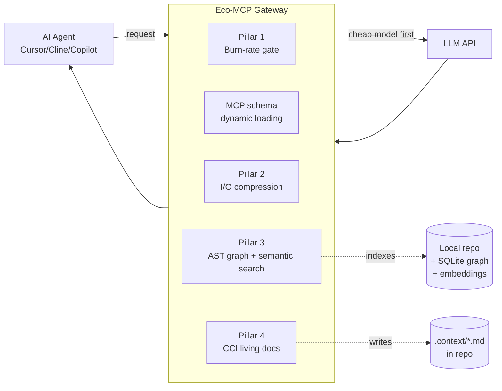

> Historical — describes the pre-2026-09-21 gateway scope.

# Infrastructure — Architecture

_Last updated: 2026-06-09. Derived from `SPEC.md` (v0), with corrections and research links._

## Shape

A **local proxy + MCP server** that sits between the AI coding agent (Cursor / Cline /
Copilot / Claude Code) and the LLM API, intercepting requests, tool calls, and command
output. Packaged as an **IDE plugin** (leaning this way over a bare daemon, for team setup
ease — see open question).

## Pillars

> **Updated 2026-06-09 after deep research** — added **Pillar 0 (Caching)**, the single
> biggest lever, absent from the original SPEC. Full findings:
> [../research/new-sparks-2026.md](../research/new-sparks-2026.md). Concrete tool picks +
> wrapper contract: [recommended-stack.md](recommended-stack.md).

### Pillar 0 — Caching & request canonicalization (the biggest single win) ⭐
*New. Not in SPEC.md. Likely 50–70% of the realistic total savings.*
- Agentic coding re-sends a large stable prefix every turn; cached reads bill at **~10% of
  input** on every provider that matters, and **Copilot's new billing passes provider cache
  pricing through**.
- **Make the gateway cache-aware:** canonicalize request prefixes deterministically (stable
  system → tools (name-sorted, key-sorted JSON) → context packs → conversation), auto-inject
  Anthropic `cache_control` breakpoints, strip cache-busters (timestamps/UUIDs near position 0),
  pin model per session, respect per-model min prefix (4096 on Opus 4.8 / Haiku 4.5).
- **Also route on model multiplier** — under Copilot, sending every turn to a high-multiplier
  model dwarfs uncached input. Downgrade easy turns; reserve top-tier for hard work.
- Standardize the egress on **LiteLLM** (cache + `cache_control` passthrough + semantic cache),
  pointing at 9router upstream. ⚠️ pin a vetted LiteLLM version (supply-chain + fallback-loop
  issues — see recommended-stack security notes).
- **Hard constraint:** caching fights context-pruning. Mid-history edits bust the cache. Design
  append-only; mutate only at threshold events. See Pillar 4-bis below.

### Pillar 1 — Pre-flight burn-rate estimator (the gatekeeper)
*Learn from: 9router routing/quota.*
- **Tokenizer engine:** local token counting (tiktoken for OpenAI; Anthropic equivalent)
  to price the payload **before** dispatch — because agents can't predict their own usage
  (Bai et al.).
- **Budget matrix:** map token counts against a live pricing matrix (per-model input/output
  rates). With Copilot now billing on real tokens, this maps directly to AI-Credit spend.
- **Hard limit + smart fallback:** if a request exceeds threshold (e.g. >$0.05), either
  auto-fall back to a cheaper tier (Haiku / GPT-mini) or prompt the user to authorize.
- **Smart routing:** trivial tasks (syntax, format, run tests, read) → cheap model by
  default; escalate to premium **only after repeated failure** (e.g. 2–3 failed test runs).

### Pillar 2 — I/O compression (the token killer)
*Learn from: rtk + caveman.*
- **CLI output truncation:** strip `[INFO]`, progress bars, success logs; inject only
  stack traces / `[ERROR]` blocks.
- **AC stripping (caveman logic):** reduce Jira/US tickets to raw functional bullets
  ("If X, do Y. Return 404").
- **Diff-only payloads:** never send whole files for a function change — force unified diffs.

### Pillar 3 — Structural + semantic retrieval (replace grep/cat)
*Learn from: codebase-memory-mcp / gortex (structural) + semble / cocoindex (semantic).*
- **Semantic:** NL queries ("how is auth handled?") → top-k code chunks via CPU-bound
  Model2Vec + BM25.
- **Structural:** AST → SQLite graph; tool calls like `get_call_hierarchy("processPayment")`,
  `find_implementations("AuthInterface")` instead of directory reads.
- **Fallback logic:** decide when semantic search is insufficient and escalate to structural,
  to avoid firing both and wasting tokens.
- **Index sync:** file-watcher keeps the graph/index fresh for uncommitted edits.

> **Add from research:** also attack **MCP tool-schema bloat** (Lever 5 in
> [../research/landscape-2026.md](../research/landscape-2026.md)) — dynamic tool loading /
> code-execution-MCP pattern (Anthropic, ~98%); don't preload 20 schemas.

### Pillar 4 — Continuous Context Integration (CCI) / living docs
*Our differentiator.*
- **`.context/` dirs** mirror the source tree (e.g. `src/modules/payment/.context/domain_logic.md`).
- **Trigger:** on US/defect completion, a command (or git hook) routes `git diff` + ticket to
  a cheap model that synthesizes business logic → appends to the module's `.context/*.md`.
- **Enforced review:** the context update is staged into the PR → **code review = context review.**
- **Injection:** future tasks read the ~1k-token Context Pack instead of the ~30k-token module.

### Pillar 5 — Small-model scaffolding (make Haiku/GPT-mini finish tasks) ⭐
*New. The mechanism that lets cheap models be the workhorses.* Build order:
1. **Context-trimming + repo few-shot** — small models are disproportionately hurt by noise.
2. **Execution-grounded repair loop (3-attempt cap)** — write → run tests/linter → feed back
   only the raw error → fix. Biggest accuracy lift. (Intrinsic "are you sure?" critique *hurts*
   small models; the signal must be real execution output.)
3. **Escalation ladder with objective stuck-detection** — escalate the *task* to a frontier
   model only on concrete signals (tests still failing after N, invalid diff, near-identical
   re-emission, budget exceeded). ~95% of frontier quality at ~14% frontier calls.
4. **Plan-then-execute, gated on complexity** — one strong plan, cheap execution of atomic steps.
5. **Constrained decoding** (if self-hosting) — constrain the edit/tool envelope, not reasoning.

### Pillar 4-bis — Context engineering (keep the working set small, cache-safely) ⭐
*New. Governs HOW pruning/retrieval interact with Pillar 0 caching.*
- **Offload + stub:** intercept large/duplicate tool outputs, spool to a local store, replace
  inline with `[ref=…, N lines]` + a `fetch(ref,range)` tool. Cache-friendly (small stable refs).
- **Sub-agent isolation:** delegate noisy sub-tasks to an isolated context; parent keeps only the
  ~1–2k summary (vs ~40k exploration). Use above a token-volume threshold (total tokens rise).
- **JIT retrieval + lazy MCP tool-schema loading;** don't toggle schemas mid-session (busts cache).
- **Compaction/pruning only at threshold events**, never per-turn mid-prefix — the #1 cost trap
  is a "savings" edit that busts a large cached prefix and costs 10× the turn it optimized.

### Routing — build on 9router, don't reinvent
9router already provides tiered Subscription→Cheap→Free fallback, per-provider quota tracking,
format translation, and bundles rtk. The gateway sits **in front** of it (gateway = retrieval +
compression + caching + MCP facade + scaffolding loop; 9router = provider routing/fallback/quota).
Add only phase-aware / cost-aware per-request model selection on top.

## Data flow (lifecycle)

1. **Init** — plugin mounts; semantic + AST indexers run lightweight background indexing
   (file-watcher on).
2. **Task ingestion** — gateway fetches the relevant Context Pack and injects it as system prompt.
3. **Agentic loop (intercepted)** — `find`/`grep` → routed to AST graph / semantic search;
   test/build output → noise-stripped to clean stack trace.
4. **Cost check** — every payload transition is priced; runaway loops / massive reads are
   halted with a projected burn-rate shown.
5. **Completion + CCI** — finalize code, auto-generate the domain-knowledge diff, stage for commit.

## Stack candidates (undecided)

- **Proxy core:** Bun, or NestJS/TypeScript, or Rust (for latency). TS favored for MCP
  ecosystem + plugin packaging; Rust if interception latency becomes the bottleneck.
- **Retrieval backends:** vendor/wrap existing binaries (semble = Python/PyPI;
  codebase-memory-mcp = C binary; gortex = Go) rather than reimplement — write thin TS
  wrappers. See [reference-repos.md](reference-repos.md).

## Target metrics (for competition eval)

- **Token efficiency:** ~90% reduction in input tokens (AST-graph retrieval + log compression).
- **Cost:** 70–80% drop in daily API/AI-Credit billing.
- **Onboarding:** near-zero ramp via auto-maintained Context Packs.
- **Maintainability:** 100% automated, PR-reviewed documentation lifecycle.

> Numbers above are targets carried from `SPEC.md`. **Validate with a real benchmark**
> (old-flow vs. gateway-flow on one task) before putting them on the pitch slide — Bai et al.
> show token usage varies up to 30× per run, so report a methodology, not a single number.
